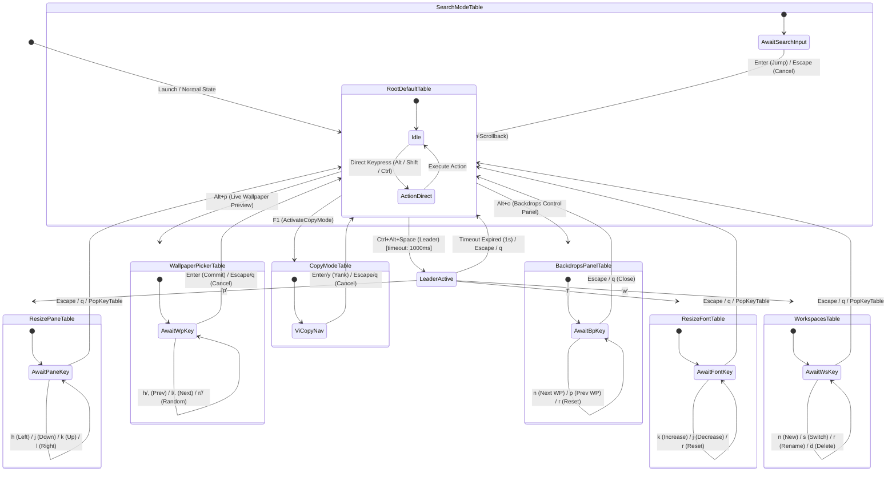

# 01 — WezTerm Deep-Dive & Key Tables Manual

<nav class="breadcrumb-nav">
  <a href="00-ecosystem-architecture.md">00 Ecosystem Architecture</a> •
  <strong>01 WezTerm Deep-Dive</strong> •
  <a href="02-kitty-mastery.md">02 Kitty Architecture</a> •
  <a href="03-tmux-masterclass.md">03 Tmux 3.8 Masterclass</a> •
  <a href="04-neovim-mastery.md">04 Neovim 0.12.6 Guide</a> •
  <a href="05-muscle-memory-drills.md">05 Muscle Memory Drills</a> •
  <a href="06-troubleshooting-runbook.md">06 Troubleshooting Runbook</a>
</nav>

---

## 1. Engine Architecture & Rendering Pipeline

WezTerm serves as the dedicated GPU development workstation terminal in this stack, triggered globally via Hyprland through `SUPER+SHIFT+RETURN`. It is engineered in Rust around a hardware-accelerated WebGPU rendering pipeline and an asynchronous Lua event architecture.

```
+-------------------------------------------------------------------------------------------------------+
|                                  WEZTERM ENGINE PIPELINE                                              |
|                                                                                                       |
|  [Hardware Events / libinput]                                                                         |
|                |                                                                                      |
|                v                                                                                      |
|  [Wayland Surface Interface]                                                                          |
|       * Compositor: Hyprland (Border suppressed via window_decorations = 'NONE')                     |
|       * Window Title: format-window-title event hooks -> 'wezterm' or active pane title               |
|                |                                                                                      |
|                v                                                                                      |
|  [WebGPU Rendering Pipeline]                                                                          |
|       * Backend: front_end = 'WebGpu'                                                                 |
|       * Power Profile: webgpu_power_preference = 'LowPower' (Integrated GPU efficiency)              |
|       * Refresh Cap: max_fps = 120, animation_fps = 120                                               |
|       * Adapter Selection: gpu_adapters:pick_best()                                                   |
|                |                                                                                      |
|                v                                                                                      |
|  [Font Shaper & Fallback Cascade]                                                                     |
|       * Primary: JetBrainsMono Nerd Font (Medium, 9.75pt, line_height = 1.1)                          |
|       * Fallback 1: Noto Sans Mono CJK SC (Simplified Chinese Monospace)                              |
|       * Fallback 2: Noto Sans CJK SC / Noto Sans CJK JP                                               |
|       * Fallback 3: Noto Color Emoji                                                                  |
|       * Rasterizer: FreeType Normal load/render targets                                               |
|                |                                                                                      |
|                v                                                                                      |
|  [Compositor Alpha & Backdrops Subsystem]                                                             |
|       * Baseline Opacity: window_background_opacity = backdrops.opacity (cached at ~/.cache/...)      |
|       * Backdrop Image Engine: Pictures/wallpaper/ scanner + Matugen wallpaper color extraction       |
|       * Frosted Overlay Wash: Adjustable wash alpha via SUPER+o control panel                         |
+-------------------------------------------------------------------------------------------------------+
```

### Key Configuration Points:
- **WebGPU Power Efficiency (`appearance.lua`):** Configured with `webgpu_power_preference = 'LowPower'`, prioritizing the integrated AMD/Intel GPU over discrete graphics. This eliminates thermal throttling and excessive battery draw while maintaining a fluid 120 Hz render loop.
- **Strict Borderless Tiling (`appearance.lua`):** `window_decorations = 'NONE'` strips both window titlebars and resize frames. This matches Hyprland's `wezterm-noborder` window rule (`border_size = 0`).
- **Tab Bar Contract (`appearance.lua`):** `hide_tab_bar_if_only_one_tab = false` is enforced. WezTerm's right-status bar and HUD pills render directly inside the top tab bar strip. Hiding the tab bar when only one tab exists would destroy visibility of the active key table badge and system health indicators.

---

## 2. Modal Key Table State Machine

WezTerm uses a modal state machine to manage complex actions without chord collisions. The global `Leader` is mapped to `Ctrl+Alt+Space` (`mod.SUPER_REV` on Linux). Pressing the Leader primes a 1-second timeout window, transitioning WezTerm into sub-key tables.



### Key Table Escape Hatches:
Every modal key table implements explicit `Escape` and `q` escape hatches mapped to `act.PopKeyTable`. Modal timeouts are bounded (`1000ms` on `resize_pane` and `resize_font`), preventing the user from ever becoming stranded in an unresponsive sub-state.

---

## 3. Dynamic Lua Status HUD & Single-Writer Protocol

Status metrics in WezTerm are governed by a strict single-writer contract implemented across `events/right-status.lua` and `events/hud.lua`. Independent event handlers competing to write the status bar cause flickering and race conditions; therefore, `right-status.lua` alone invokes `window:set_right_status()`.

### Visual Segment Layout:
```
[HUD Pills: KEY TABLE | REMOTE HOST | PANE CMD]  [DATE] 󰸗 Tue 15 Nov  [HOST] sahil-box  [UPTIME] 4h 12m  [BATTERY] 󰂀 88%  [CLOCK] 󰥔 21:04
```

### Segment Architecture & WCAG AA Contrast:
1. **Contextual HUD (`events/hud.lua`):**
   - **Active Key Table Badge:** Interrogates `window:active_key_table()`. When active, it emits a prominent bold badge naming the table (e.g. `LEADER`, `RESIZE_PANE`, `WORKSPACES`).
   - **Remote Host Pill:** Reads OSC 1337 terminal sequence data (`pane:get_osc_data().Hostname`). If the pane is connected across SSH to an external host, a bright alarm pill highlights the remote machine identity. It renders nothing when running locally.
2. **Persistent System Status (`events/right-status.lua`):**
   - Formatted into structured `FormatItem` token lists using `utils/cells.lua`.
   - All colors derive dynamically from `utils/tokens.lua` and the Matugen wallpaper extraction palette.
   - Contrast is strictly enforced: `MIN_CONTRAST = 4.5` (WCAG AA). If a derived foreground token fails relative luminance against the background, it is mathematically shifted along its luminance curve until legibility is guaranteed.

---

## 4. Interactive Workspaces & QuickSelect Mechanics

### Workspaces Subsystem (`utils/workspaces.lua`):
Named workspaces isolate distinct development efforts. Each workspace maintains its own set of tabs, active pane directories, and process states:
- **`Leader w n`:** Prompts for a workspace name via `act.PromptInputLine` and spawns or switches to it.
- **`Leader w s` (or `Alt+s`):** Launches an interactive fuzzy fuzzy selector over all active workspaces.
- **`Leader w r`:** Interactively renames the active workspace.
- **`Leader w d`:** Prompts for confirmation before destroying the current workspace and safely returning the client to `default`.

### QuickSelect & Hyperlink Protocol (`config/general.lua`):
- **Universal QuickSelect (`Ctrl+Shift+Space`):** Enters zero-mouse copy mode, tagging matching regular expressions with mnemonic single-letter tags.
- **Configured Extraction Regexes:**
  - Compiler errors and stack traces: `[.\w/\-_]+\.[a-zA-Z0-9]+:[0-9]+(:[0-9]+)?`
  - Git commit hashes: `\b[0-9a-f]{7,40}\b`
  - IPv4 addresses & ports: `\b[0-9]{1,3}\.[0-9]{1,3}\.[0-9]{1,3}\.[0-9]{1,3}(:[0-9]+)?\b`
  - Localhost endpoints: `\blocalhost:[0-9]+\b`
- **Clickable Compiler Error Jumper (`open-uri` event):** Clicking on compiler errors matching `file://path#line` automatically opens Neovim directly at the target line in a new tab:
  ```lua
  wezterm.on('open-uri', function(window, pane, uri)
     local path, line = uri:match('^file://([^#]+)#(%d+)$')
     if not path then return end
     window:perform_action(
        wezterm.action.SpawnCommandInNewTab({
           args = { 'nvim', '+' .. line, path },
           cwd = pane:get_current_working_dir() and pane:get_current_working_dir().file_path or nil,
        }),
        pane
     )
     return false
  end)
  ```

---

## 5. Exhaustive Keymap Encyclopedia

Every keybinding verified directly from the running runtime (`wezterm show-keys`) and `~/.config/wezterm/config/bindings.lua`.

### Group A: Root & Direct Keybindings

| Key Combination | Action Description | Underlying Action / Target |
|---|---|---|
| `Alt + Enter` | Toggle active pane zoom | `TogglePaneZoomState` |
| `Alt + Ctrl + Enter` | Reset backdrop wash / opacity | `backdrops:cycle_wash_down` |
| `Alt + +` / `Alt + =` | Increase backdrop image index | `backdrops:cycle_forward` |
| `Alt + -` / `Alt + _` | Decrease backdrop image index | `backdrops:cycle_back` |
| `Alt + .` / `Alt + >` | Step to next wallpaper | `backdrops:cycle_forward` |
| `Alt + ,` / `Alt + <` | Step to previous wallpaper | `backdrops:cycle_back` |
| `Alt + /` | Step to random wallpaper | `backdrops:cycle_random` |
| `Alt + Ctrl + /` | Cycle background image mode | `backdrops:cycle_back` |
| `Alt + 0` | Interactively rename current tab title | `EmitEvent("tabs.manual-update-tab-title")` |
| `Alt + Ctrl + 0` | Reset active tab title to default | `EmitEvent("tabs.reset-tab-title")` |
| `Alt + Ctrl + 9` | Toggle top tab bar visibility | `EmitEvent("tabs.toggle-tab-bar")` |
| `Ctrl + c` | Copy active selection to system clipboard | `CopyTo(Clipboard)` |
| `Ctrl + v` | Paste text from system clipboard | `PasteFrom(Clipboard)` |
| `Ctrl + t` / `Alt + t` | Spawn new tab in default domain | `SpawnTab(DefaultDomain)` |
| `Alt + n` | Spawn new WezTerm window | `SpawnWindow` |
| `Alt + [ ` / `Ctrl + Shift + [` | Activate previous tab | `ActivateTabRelative(-1)` |
| `Alt + ] ` / `Ctrl + Shift + ]` | Activate next tab | `ActivateTabRelative(1)` |
| `Alt + Ctrl + [` | Move current tab left | `MoveTabRelative(-1)` |
| `Alt + Ctrl + ]` | Move current tab right | `MoveTabRelative(1)` |
| `Alt + 1` .. `Alt + 9` | Activate tab by index (1 through 9) | `ActivateTab(0 .. 8)` |
| `Alt + f` | Incremental scrollback search | `Search(CaseInSensitiveString(""))` |
| `Alt + o` | Open Backdrops Interactive Control Panel | `ActivateKeyTable("backdrops_panel")` |
| `Alt + p` | Open Fullscreen Wallpaper Live Picker | `ActivateKeyTable("wallpaper_picker")` |
| `Alt + Ctrl + p` | Pane selection overlay (swap with active) | `PaneSelect(mode = SwapWithActiveKeepFocus)` |
| `Alt + Ctrl + r` | Spawn interactive project task runner in new tab | `project-task; exec zsh -l` |
| `Alt + s` | Show interactive workspace fuzzy selector | `workspaces.switch_workspace` |
| `Alt + Ctrl + s` | Open Project Hub in new tab (Tmux meeting point) | `exec "$HOME/.local/bin/project-hub"` |
| `Alt + Ctrl + S` | Prompt to create new named workspace | `workspaces.new_workspace` |
| `Alt + u` / `Alt + Shift + u` | Increase / decrease backdrop frost wash | `backdrops:adjust_wash` |
| `Alt + y` / `Alt + Shift + y` | Increase / decrease window background opacity | `backdrops:adjust_opacity` |
| `Alt + Ctrl + u` | QuickSelect URL grabber with regex patterns | `QuickSelectArgs(open url)` |
| `Alt + Ctrl + w` | Close current tab (unconfirmed) | `CloseCurrentTab { confirm: false }` |
| `Alt + Ctrl + x` | Close current pane (confirmed) | `CloseCurrentPane { confirm: true }` |
| `Alt + Ctrl + Q` | Quit WezTerm application | `QuitApplication` |
| `Alt + Backspace` | Send Unix Line Discard (`\x15` / `Ctrl+U`) | `SendString("\u{15}")` |
| `Ctrl + Shift + Space` | Trigger QuickSelect mode (URLs, hashes, errors) | `QuickSelect` |
| `Shift + PageUp` | Jump to previous semantic command prompt | `ScrollToPrompt(-1)` |
| `Shift + PageDown` | Jump to next semantic command prompt | `ScrollToPrompt(1)` |
| `F1` | Enter Vi Copy Mode | `ActivateCopyMode` |
| `F2` | Open interactive Command Palette | `ActivateCommandPalette` |
| `F3` | Open general Launcher menu | `ShowLauncher` |
| `F4` | Open Fuzzy Tabs Launcher | `ShowLauncherArgs(FUZZY \| TABS)` |
| `F5` | Open Fuzzy Workspaces Launcher | `ShowLauncherArgs(FUZZY \| WORKSPACES)` |
| `F6` | Open Fuzzy Command Palette Launcher | `ShowLauncherArgs(FUZZY \| COMMANDS)` |
| `F11` | Toggle window fullscreen | `ToggleFullScreen` |
| `F12` | Open WezTerm Debug Overlay | `ShowDebugOverlay` |

### Group B: Leader Chords (`Ctrl+Alt+Space` -> Key)

| Chord | Action Description | Underlying Target |
|---|---|---|
| `Leader + Space` | Send raw Leader keypress to application | `SendKey { key: 'Space', mods: 'CTRL\|ALT' }` |
| `Leader + p` | Activate Pane Resizing Key Table | `ActivateKeyTable("resize_pane", timeout = 1000ms)` |
| `Leader + f` | Activate Font Resizing Key Table | `ActivateKeyTable("resize_font", timeout = 1000ms)` |
| `Leader + w` | Activate Workspaces Management Key Table | `ActivateKeyTable("workspaces")` |
| `Leader + \|` | Split pane horizontally (side-by-side) | `SplitHorizontal { domain: CurrentPaneDomain }` |
| `Leader + -` | Split pane vertically (stacked) | `SplitVertical { domain: CurrentPaneDomain }` |
| `Leader + c` | Spawn new tab | `SpawnTab(CurrentPaneDomain)` |
| `Leader + x` | Close current pane with confirmation prompt | `CloseCurrentPane { confirm: true }` |
| `Leader + z` | Toggle active pane zoom state | `TogglePaneZoomState` |

### Group C: Modal Key Table — `resize_pane` (`Leader + p`)

| Key | Action |
|---|---|
| `h` | Adjust pane size left by 1 column |
| `j` | Adjust pane size down by 1 row |
| `k` | Adjust pane size up by 1 row |
| `l` | Adjust pane size right by 1 column |
| `Escape` / `q` | Exit resize mode and return to normal table (`PopKeyTable`) |

### Group D: Modal Key Table — `resize_font` (`Leader + f`)

| Key | Action |
|---|---|
| `k` | Increase font size by 1.0pt (`IncreaseFontSize`) |
| `j` | Decrease font size by 1.0pt (`DecreaseFontSize`) |
| `r` | Reset font size to default 9.75pt (`ResetFontSize`) |
| `Escape` / `q` | Exit font resize mode (`PopKeyTable`) |

### Group E: Modal Key Table — `workspaces` (`Leader + w`)

| Key | Action |
|---|---|
| `n` | Prompt for new workspace name and switch to it |
| `s` | Open fuzzy input selector across all existing workspaces |
| `r` | Prompt to rename the active workspace |
| `d` | Prompt to delete the active workspace (returns focus to `default`) |
| `Escape` / `q` | Exit workspaces key table (`PopKeyTable`) |

### Group F: Modal Key Table — `wallpaper_picker` (`Alt + p`)

| Key | Action |
|---|---|
| `h` / `LeftArrow` / `,` | Step to previous wallpaper in sequence |
| `l` / `RightArrow` / `.` | Step to next wallpaper in sequence |
| `r` / `/` | Jump to random wallpaper |
| `Enter` | Commit current wallpaper & trigger dynamic theme cascade |
| `Escape` / `q` | Cancel picker and revert to previous wallpaper |

### Group G: Modal Key Table — `backdrops_panel` (`Alt + o`)

| Key | Action |
|---|---|
| `k` / `UpArrow` | Increase backdrop artwork frost wash (+0.05) |
| `j` / `DownArrow` | Decrease backdrop artwork frost wash (-0.05) |
| `l` / `RightArrow` | Increase window background compositor opacity (+0.02) |
| `h` / `LeftArrow` | Decrease window background compositor opacity (-0.02) |
| `n` | Next wallpaper image |
| `p` | Previous wallpaper image |
| `r` | Reset wash and opacity to defaults |
| `Escape` / `q` | Close control panel (`PopKeyTable`) |

### Group H: Mouse Bindings

| Event / Chord | Context | Action |
|---|---|---|
| `Left Click (Up, Streak 1)` | Normal | Complete selection and copy to clipboard (`CompleteSelectionOrOpenLinkAtMouseCursor`) |
| `Ctrl + Left Click (Up)` | Normal | Open link / URL under mouse cursor (`OpenLinkAtMouseCursor`) |
| `Middle Click (Down)` | Normal | Paste text from primary selection (`PasteFrom(PrimarySelection)`) |
| `Double Click (Left)` | Normal | Select word under cursor (`SelectTextAtMouseCursor(Word)`) |
| `Triple Click (Left)` | Normal | Select whole line under cursor (`SelectTextAtMouseCursor(Line)`) |
| `Alt + Drag (Left)` | Normal | Block / rectangular selection mode (`ExtendSelectionToMouseCursor(Block)`) |
| `Shift + Ctrl + Drag` | Normal | Initiate Wayland window drag (`StartWindowDrag`) |
