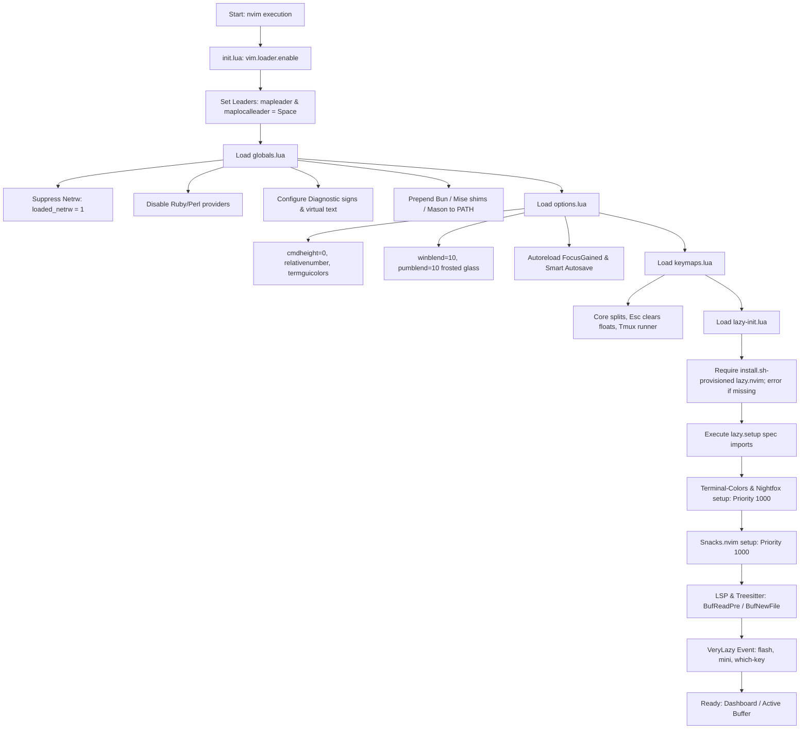

# 04 — Neovim 0.12.6 Architecture & Mastery Guide

<nav class="breadcrumb-nav">
  <a href="00-ecosystem-architecture.md">00 Ecosystem Architecture</a> •
  <a href="01-wezterm-mastery.md">01 WezTerm Deep-Dive</a> •
  <a href="02-kitty-mastery.md">02 Kitty Architecture</a> •
  <a href="03-tmux-masterclass.md">03 Tmux 3.8 Masterclass</a> •
  <strong>04 Neovim 0.12.6 Guide</strong> •
  <a href="05-muscle-memory-drills.md">05 Muscle Memory Drills</a> •
  <a href="06-troubleshooting-runbook.md">06 Troubleshooting Runbook</a>
</nav>

---

## 1. Boot Sequence & Module Pipeline

Neovim 0.12.6 is tuned for fast startup (~70ms headless boot, measured with `hyperfine 'nvim --headless +qa'`) using LuaJIT bytecode caching, selective plugin loading, lazy-loaded debug UI, and disabled legacy providers.



### Critical Engine Optimizations:
- **Bytecode Cache (`vim.loader.enable()`):** Caches parsed Lua bytecode into disk-backed memory buffers, reducing Lua parse overhead. Lazily loading `nvim-dap-ui` (which was pulling the whole DAP stack into boot) cut measured headless startup from ~144ms to ~72ms.
- **Provider Pruning (`globals.lua`):** Hard-disables `loaded_ruby_provider = 0` and `loaded_perl_provider = 0`. Node.js provider routes cleanly to Bun's global `neovim-node-host`.
- **Single-Writer Terminal Color Adoption (`terminal-colors.lua`):**
  Neovim determines host profile via `TERMINAL_STACK_PROFILE`. It queries the host terminal's live OSC 4/10/11 palette and maps it onto Catppuccin's semantic slots, re-tinting when Kitty (Apple Dark Glass) or WezTerm changes theme; TERMINAL_STACK_PROFILE only selects the fallback palette file when OSC queries are unavailable (headless or inside Tmux). Color overrides are calculated live to satisfy WCAG AA relative contrast ($\ge 4.5:1$).
- **Syntax Hierarchy Engine (`hierarchy.lua`):**
  Applies an uncompromising cognitive rule:
  - *Demote Structure:* Comments, operators, brackets, and punctuation are forced into muted overlay tones (`@punctuation`, `@operator`).
  - *Promote Information:* Diagnostics (errors/warnings), the active cursor line, and Git hunk modifications receive full contrast weight.

---

## 2. Core Tooling & Utility Subsystems

### Tmux & Terminal Code Runner (`lua/utils/runner.lua`):
Provides IDE-grade code execution directly into an adjacent Tmux pane. Triggered via the `<leader>r` group:
1. **Runner Detection & Auto-Creation:**
   When `<leader>rc` (run file) or `<leader>rl` (run line) is pressed, `get_or_create_runner_pane()` inspects the current window. If an existing non-editor pane exists, it targets it. If no runner exists, it automatically creates a 30% height horizontal split below Neovim, leaving editor focus intact:
   ```lua
   local new_pane = vim.fn.system("tmux split-window -v -l 30% -P -F '#{pane_id}'"):gsub('%s+', '')
   vim.fn.system('tmux select-pane -t ' .. cur_pane)
   ```
2. **Language Dispatch Matrix:**
   - Python: Resolves virtualenv via `utils.python_env` or uses `python3`.
   - TypeScript: Dispatches to `bun`, `npx tsx`, or `ts-node`.
   - JavaScript: `node`.
   - Go: `go run .`
   - Rust: `cargo run`.
   - Shell: `bash` / `zsh`.
   - Lua: `nvim -l`.
   - PHP: `php`.
3. **Interactive REPL (`<leader>rt`):**
   Spawns `ipython`, `bun repl`, `node`, `lua`, or `php -a` inside the runner pane.
4. **Runner Control:**
   - `<leader>rp`: Switches cursor focus straight to the runner pane.
   - `<leader>rk`: Sends `Ctrl+c` to kill running tasks and clears the runner pane (`clear`).

### Modular Spec Extension (`opts_extend`):
Neovim uses LazyVim's native `opts_extend` convention. Rather than overriding plugin tables in single massive monoliths, modular files in `lua/plugins/languages/*.lua` simply extend tables:
```lua
{
  'WhoIsSethDaniel/mason-tool-installer.nvim',
  opts_extend = { 'ensure_installed' },
  opts = {
    ensure_installed = { 'basedpyright', 'ruff', 'stylua', 'prettierd' },
  },
}
```

---

## 3. The 10 Leader Groups Operational Guide

Neovim's leader is `Space`. All custom commands are organized into 10 semantic groups:

```
+-------------------------------------------------------------------------------------------------------+
|                                    NEOVIM LEADER GROUPS (<leader> = Space)                            |
+-------------------------------------------------------------------------------------------------------+
|  <leader>f  Find Files, Buffers, Projects, Rings    |  <leader>b  Buffer Management & Sort            |
|  <leader>s  Search Grep, AST Symbols, Diagnostics   |  <leader>g  Git Hunks, Lazygit, Diffview, Octo  |
|  <leader>r  Tmux Code Runners & REPL Dispatch       |  <leader>c  Code Actions, Rename, Format, LSP   |
|  <leader>w  Window Management & Synchronized Zoom   |  <leader>t  Neotest Suite & Trouble Triage      |
|  <leader>u  UI Toggles (Wrap, Numbers, Inlay Hints) |  <leader>d  DAP Debugger (Breakpoints, Stack)   |
+-------------------------------------------------------------------------------------------------------+
```

### 1. Find — `<leader>f`
- `<leader>ff` / `<leader><space>`: Fuzzy find files across project root (hidden files included).
- `<leader>fg`: Find Git-tracked files only.
- `<leader>fb` / `<leader>,`: Fast buffer switcher (sorted MRU).
- `<leader>fr`: File ring (recently visited file history via `mini.visits`).
- `<leader>fR`: Full recent files picker (`snacks.picker.recent`).
- `<leader>fp`: Fuzzy switch between registered project directories.
- `<leader>ft`: Toggle floating terminal in current file's working directory.
- `<leader>fT`: Toggle floating terminal at git repository root.

### 2. Search — `<leader>s`
- `<leader>sg`: Project live grep (ripgrep with regex support).
- `<leader>sw`: Grep word under cursor across project.
- `<leader>su`: Grep active visual selection across project.
- `<leader>sr`: Launch Grug-far: interactive search and replace across the entire project.
- `<leader>sb`: Fuzzy search inside the current buffer.
- `<leader>ss` / `<leader>sS`: Document symbols / Workspace symbols picker.
- `<leader>sd` / `<leader>sD`: Document diagnostics / Workspace diagnostics picker.
- `<leader>sk`: Interactive keymap browser (all live keybindings).
- `<leader>sy`: Yank history clipboard ring (browse and paste previous clips).
- `<leader>st` / `<leader>sT`: Todo comments picker (`TODO`, `FIX`, `HACK`, `WARN`).
- `<leader>sU`: Undo history tree picker.
- `<leader>sR`: Resume last active picker state.

### 3. Code Runner & REPL — `<leader>r`
- `<leader>rc` / `<leader>rf`: Run current file in adjacent Tmux runner pane.
- `<leader>rl`: Send current line under cursor to runner and step forward.
- `<leader>rs` / `<leader>r` (visual): Send highlighted visual lines to runner pane.
- `<leader>rt`: Start or toggle interactive REPL for current filetype.
- `<leader>rp`: Switch keyboard focus directly to runner pane.
- `<leader>rk`: Interrupt running job (`SIGINT`) and clear the runner pane.

### 4. Windows & Zoom — `<leader>w`
- `<leader>wd`: Close current window split (`<C-w>c`).
- `<leader>wm` / `<leader>Z`: Maximize / zoom current window within Neovim (`Snacks.zen.zoom`).
- `<leader>wz`: **Synchronized Zoom** — Zooms the Neovim split AND instructs outer Tmux to zoom the pane (`tmux resize-pane -Z`).
- `<leader>|`: Vertical split side-by-side (`:vsplit`).
- `<leader>-`: Horizontal split stacked (`:split`).

### 5. UI Toggles — `<leader>u`
- `<leader>uw`: Toggle line wrapping and word breaks (`vim.wo.wrap`).
- `<leader>ul`: Toggle line numbers and relative numbers.
- `<leader>ud`: Toggle LSP diagnostics visibility inline.
- `<leader>uc`: Toggle markdown / syntax conceal levels (0 vs 2).
- `<leader>uh` / `<leader>th`: Toggle LSP inlay hints.
- `<leader>us`: Toggle spell check.
- `<leader>ua` / `<leader>uA`: Toggle auto-format on save (global / buffer).
- `<leader>ut`: Toggle Treesitter context sticky header.
- `<leader>uu`: Open persistent graphical Undo Tree (`undotree`).
- `<leader>uf` / `<leader>uF`: Undo to last file write / Redo to next file write.
- `<leader>un`: Dismiss all active floating notifications.

### 6. Buffer Management — `<leader>b`
- `<leader>bd`: Delete current buffer safely (`snacks.bufdelete`).
- `<leader>bo`: Delete all other buffers except current (`snacks.bufdelete.other`).
- `<leader>bD`: Wipe buffer forcefully (`:bwipeout`).
- `<leader>bp`: Pick buffer visually from top bufferline tab strip.
- `<leader>bs`: Toggle bufferline sorting order (by directory vs extension).
- `[b` / `]b` or `<S-h>` / `<S-l>`: Step to previous / next buffer.

### 7. Git Hub — `<leader>g`
- `]c` / `[c`: Jump to next / previous Git modification hunk.
- `<leader>ghs` / `<leader>ghr`: Stage / reset hunk under cursor (normal and visual).
- `<leader>ghu`: Undo staged hunk.
- `<leader>ghp`: Preview hunk diff in floating popup.
- `<leader>gbs` / `<leader>gbr`: Stage / reset entire buffer.
- `<leader>gbl`: Toggle inline git blame on active line.
- `<leader>gB`: Open full commit blame popup with author, hash, and date.
- `<leader>gG`: Open file and line on GitHub web via `snacks.gitbrowse`.
- `<leader>gg`: Launch floating LazyGit interface.
- `<leader>gD`: Open Diffview side-by-side git diff against index.
- `<leader>gH`: Open Diffview file history browser.
- `<leader>gq`: Close Diffview tab.
- `<leader>gco` / `gct` / `gcb` / `gc0`: Resolve merge conflict: choose ours, theirs, both, none.
- `<leader>gP`: Open GitHub Dashboard (pull requests, issues, reviews).

### 8. Code & LSP Actions — `<leader>c`
- `gd` / `gD`: Goto Definition / Goto Declaration (via `snacks.picker`).
- `gr`: List all references (excluding definition line).
- `gI` / `gy`: Goto Implementation / Goto Type Definition.
- `K`: Hover documentation popup (rounded border, line wrapped).
- `<leader>ca`: Trigger LSP code actions for diagnostic at cursor.
- `<leader>cr`: LSP semantic rename across project files.
- `<leader>cf`: Format buffer or selection via Conform (`stylua`, `prettierd`, `ruff`, etc.).
- `<leader>cy`: Yank formatted diagnostic string to system clipboard.
- `<leader>ck` / `<C-k>` (insert): Signature help float.
- `<leader>cx`: Run LSP Code Lens action on current line.
- `<leader>ci` / `<leader>cI`: Incoming calls / Outgoing calls LSP hierarchy.

### 9. Test & Diagnostics — `<leader>t`
- `<leader>tt`: Run nearest test under cursor (`neotest`).
- `<leader>tr`: Run entire test file.
- `<leader>tT`: Run all test suites across project.
- `<leader>tl`: Re-run last test execution.
- `<leader>ts`: Toggle interactive test summary panel.
- `<leader>to` / `<leader>tO`: Show test output popup / Toggle test output terminal.
- `<leader>tw`: Toggle test watching mode on active file.
- `<leader>tS`: Stop running test execution.
- `<leader>xx`: Toggle Trouble diagnostics panel (workspace view).
- `<leader>cd` / `<leader>cD`: Trouble diagnostics for current buffer / workspace.
- `<leader>cs` / `<leader>cl`: Trouble document symbols / LSP definitions.

### 10. Debugging Suite (DAP) — `<leader>d`
- `<leader>db`: Toggle breakpoint on current line.
- `<leader>dB`: Set conditional breakpoint (prompts for condition expression).
- `<leader>dc`: Start / continue debugger execution.
- `<leader>dC`: Run to cursor position without setting permanent breakpoint.
- `<leader>di` / `<leader>do` / `<leader>dO`: Step into / Step over / Step out.
- `<leader>dj` / `<leader>dk`: Navigate down / up the execution call stack.
- `<leader>de`: Evaluate expression under cursor (normal and visual).
- `<leader>dg`: Go to line without executing.
- `<leader>dr`: Toggle DAP interactive REPL.
- `<leader>du`: Toggle graphical DAP UI debugger windows.
- `<leader>dt`: Terminate debugging session.
- `<leader>dw`: Hover variable widgets inspector.
- `<leader>dPt` / `<leader>dPc`: Debug Python test method / test class.

---

## 4. Surgical Editing & AST Navigation

### 1. Flash.nvim (`s` / `S` / `R`):
- `s` (Normal / Visual / Operator): Activates 2-character bi-directional jump labels across all visible text. Replaces standard search navigation with sub-second targeting.
- `S` (Visual / Operator): Treesitter node expansion jump. Visualizes AST parent/child nodes and selects full semantic code blocks.
- `R`: Treesitter search mode. Type query to match AST patterns across current function.
- `<C-s>` (Command-line): Toggle Flash integration within standard Vim search `/`.

### 2. Mini.surround (`gsa`, `gsd`, `gsr`):
- `gsa<motion><char>`: Add surrounding delimiter around motion (e.g. `gsaiw"` surrounds inner word with quotes).
- `gsd<char>`: Delete surrounding delimiter (e.g. `gsd'` strips surrounding quotes).
- `gsr<old><new>`: Replace surrounding delimiter (e.g. `gsr'"` replaces single quotes with double).
- `gsn`: Interactive update to search span across N lines (`MiniSurround.update_n_lines()`).

### 3. Mini.ai Syntax Textobjects:
Combines standard text objects with deep Treesitter AST awareness:
- `af` / `if`: Around / inside function body.
- `ac` / `ic`: Around / inside class declaration.
- `aa` / `ia`: Around / inside parameter / argument.
- `ab` / `ib`: Around / inside code block.

### 4. Oil.nvim File System Buffer (`-` / `<leader>O`):
- Pressing `-` opens the current directory directly as an editable text buffer:
  - Rename a file: Edit the line with standard Vim motions (`cw`) and save (`:w`).
  - Create files: Add a new line with the filename and save (`:w`).
  - Delete files: Delete the line (`dd`) and save (`:w`).
  - Move files: Cut line (`dd`), navigate into target folder buffer, paste (`p`), and save (`:w`).
- `<leader>O`: Opens Oil in a floating frosted-glass window (`winblend = 25`).

### 5. Native Quickfix Refactoring Pipeline:
Refactor symbols across 40+ project files without plugins:
1. Search across project: `<leader>sg` -> Type pattern -> Press `<C-q>` to dump results to Quickfix list.
2. Filter matches: Run `:Cfilter /pattern/` to narrow down results.
3. Delete unwanted matches: In the quickfix window, press `dd` to delete lines.
4. Execute bulk transformation:
   ```vim
   :cfdo %s/old_identifier/new_identifier/g | update
   ```

---

## 5. Live Runtime Keymap Encyclopedia

> **Runtime Verification & Tally:**
> - **Interactive User-Facing Keymaps (`<Space>sk` / `Snacks.picker.keymaps`):** **511 active keymaps** (filters internal `<Plug>` macros).
> - **Global Normal Mode Maps (`n`):** **394** (including **157** dedicated `<Space>` leader chords).
> - **Total Underlying Engine Registrations:** **893** (including all buffer-local maps and internal `<Plug>` macros).

Every core mapping verified against `~/.config/nvim/lua/keymaps.lua`, `~/.cache/nvim/keymaps_dump.json`, and live `<Space>sk` picker.

| Keys | Mode | Category / Action Description |
|---|---|---|
| `<Esc>` | n | Clear search highlighting and dismiss lingering floating windows |
| `<leader>vs` | n | Python Venv: interactive virtualenv selector (`:VenvSelect`) |
| `<leader>vc` | n | Python Venv: re-apply cached project virtualenv |
| `<leader>gco` | n | Git Conflict: choose OURS version (`<Cmd>GitConflictChooseOurs<CR>`) |
| `<leader>gct` | n | Git Conflict: choose THEIRS version (`<Cmd>GitConflictChooseTheirs<CR>`) |
| `<leader>gcb` | n | Git Conflict: choose BOTH versions (`<Cmd>GitConflictChooseBoth<CR>`) |
| `<leader>gc0` | n | Git Conflict: choose NONE (`<Cmd>GitConflictChooseNone<CR>`) |
| `<leader>sy` | n | Yank History: browse and paste previous clips (`<Cmd>YankyRingHistory<CR>`) |
| `<leader>bp` | n | Bufferline: interactive tab pick (`<Cmd>BufferLinePick<CR>`) |
| `<leader>bs` | n | Bufferline: toggle buffer sorting order (MRU vs extension) |
| `<leader>\|` | n | Vertical split side-by-side (`:vsplit`) |
| `<leader>-` | n | Horizontal split stacked (`:split`) |
| `<leader>wd` | n | Delete / close current window split (`<C-w>c`) |
| `<leader>wm` | n | Toggle window zoom mode (`Snacks.zen.zoom()`) |
| `<leader>wz` | n | Synchronized zoom: zoom Neovim split AND outer Tmux pane |
| `<leader><tab>d` | n | Close active tab (`:tabclose`) |
| `<C-Up>` | n | Increase window height by 2 rows (`resize +2`) |
| `<C-Down>` | n | Decrease window height by 2 rows (`resize -2`) |
| `<C-Left>` | n | Decrease window width by 2 columns (`vertical resize -2`) |
| `<C-Right>` | n | Increase window width by 2 columns (`vertical resize +2`) |
| `<Esc><Esc>` | t | Exit Neovim terminal mode to normal navigation (`<C-\><C-n>`) |
| `]q` / `[q` | n | Step to next / previous quickfix item (wraps at list ends) |
| `]l` / `[l` | n | Step to next / previous location list item (wraps at ends) |
| `]d` / `[d` | n | Step to next / previous diagnostic |
| `]e` / `[e` | n | Step to next / previous ERROR diagnostic |
| `gl` | n | Open floating diagnostics popup for current line |
| `<leader>cy` | n | Yank line diagnostics text directly to OS clipboard |
| `n` / `N` | n | Next / previous search match (keeps cursor vertically centered `zzzv`) |
| `<C-d>` / `<C-u>`| n | Half-page jump down / up (keeps cursor centered `zz`) |
| `<C-l>` | i | Skip past closing delimiter (bracket, quote, comma) in insert mode |
| `<` / `>` | v | Indent / outdent selected visual block while keeping selection |
| `<A-j>` / `<A-k>`| n, i, v | Move active line or selection down / up by 1 line |
| `j` / `k` | n, x | Move visual line down / up when line is soft-wrapped |
| `<leader>uw` | n | Toggle line wrapping on / off |
| `<leader>ul` | n | Toggle line numbers & relative line numbers |
| `<leader>ud` | n | Toggle inline diagnostics on / off |
| `<leader>uc` | n | Toggle syntax conceal level (0 vs 2) |
| `<leader>uh` / `th`| n | Toggle LSP inlay hints |
| `<leader>us` | n | Toggle spell checking |
| `<leader>rc` / `rf`| n | Execute current file in Tmux runner pane |
| `<leader>rl` | n | Send current line to runner pane and step forward |
| `<leader>rs` / `r` | n, v | Send active line / visual selection to Tmux runner pane |
| `<leader>rt` | n | Start or toggle interactive REPL in runner pane |
| `<leader>rp` | n | Focus cursor onto adjacent Tmux runner pane |
| `<leader>rk` | n | Kill running runner process (`C-c`) and clear runner pane |
| `-` | n | Open parent directory as buffer in Oil (`:Oil`) |
| `<leader>O` | n | Open floating Oil directory editor (`:Oil --float`) |
| `s` | n, x, o | Flash: 2-character bi-directional jump across screen |
| `S` | o, x | Flash: Treesitter node expansion jump |
| `R` | o, x | Flash: Treesitter search |
| `<C-s>` | c | Flash: Toggle search highlighting inside `/` |
| `gsa` | n, v | Mini.surround: Add surrounding delimiters around motion |
| `gsd` | n | Mini.surround: Delete surrounding delimiter |
| `gsr` | n | Mini.surround: Replace surrounding delimiter |
| `gsf` / `gsF` | n | Mini.surround: Find delimiter right / left |
| `gsn` | n | Mini.surround: Set search span across N lines |
| `<leader>qq` | n | Save current session state (`MiniSessions.write 'last'`) |
| `<leader>ql` | n | Load last active session (`MiniSessions.read()`) |
| `<leader>qs` | n | Select and load saved session (`MiniSessions.select()`) |
| `<leader>l` | n | Open Lazy.nvim interactive actions picker (Sync, Update, Clean) |
| `<leader>P` | n | Open interactive Project Tasks menu (`project-task`) |
| `<leader>Pr` / `Pt`| n | Run / test current project via `project-task` |
| `<leader>Pl` / `Pf`| n | Lint / format current project via `project-task` |
